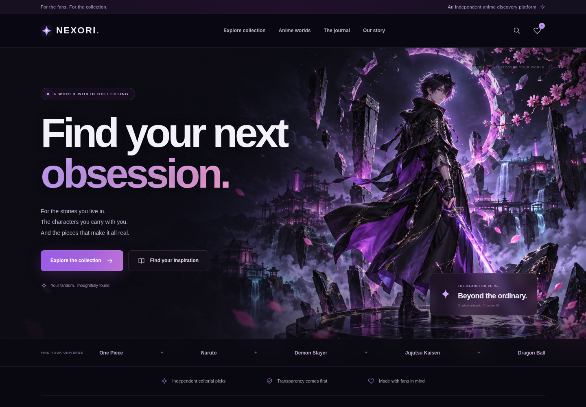

# NEXORI

A new, responsive anime discovery website, built from scratch with vanilla JavaScript and Vite. The site keeps the dark violet, pink, and cyan direction of the supplied visual reference.

## Visual preview

These screenshots show the running application. The repository stores source code; it is not a publicly hosted website.



[View the mobile screenshot](docs/mobile-preview.png)

The latest design adds an original cinematic anime banner in the dark violet/pink palette, glass accents, refined typography, interactive inspiration tabs, a **Surprise me** discovery button, and a dedicated desk-and-room inspiration feature. The banner is embedded in the standalone HTML, too.

The main headline is **Your Portal to Authentic Anime Culture & Collectibles**, with a slow, restrained neon color effect. Text throughout the site is larger; navigation and anime-world links use visible neon outlines. The original banner has a subtle breathing sword glow and three independently floating rocks. As you scroll, the banner continues down into the beginning of the content, with its lower edge fading into the background. A floating toolbar provides saved finds, surprise discovery, and back-to-top actions after scrolling. All decorative motion respects the browser's reduced-motion preference. [View the floating toolbar](docs/floating-tools-preview.png).

[View the banner animation](docs/banner-motion.gif) · [Desktop while scrolling](docs/banner-scroll-preview.png) · [Mobile while scrolling](docs/mobile-banner-scroll-preview.png)

## Open as a single HTML file

Download [NEXORI.html](NEXORI.html), then open the downloaded file in a modern browser. This self-contained version now includes the actual Firebase sign-in/editor, CSS, JavaScript and all original illustrations. It bundles all modules inline and uses hash navigation, so it is built to open without a local server or Node installation. A prominent **כניסה לניהול האתר** button appears at the top of the HTML; **Owner sign-in** is also enlarged in the footer. Cloud reads, sign-in and saving require Internet access and the existing verified manager role. Public Web configuration is embedded, never passwords or privileged keys. Without configuration it displays setup instructions.

The bundled app passed real-SDK emulator checks over HTTP, plus opaque-origin sign-in/save checks without browser storage. Actual double-click `file://` navigation is blocked by the cloud browser's managed URL policy, so Windows/local-file compatibility still needs the operator's check. The existing working Windows local-server package remains available. Browser restrictions may make favorites or authentication temporary; Auth uses session storage where supported and falls back to memory otherwise.

GitHub's file page displays source code rather than running HTML. Use the file's **Download raw file** button and open it from your Downloads folder. Alternatively, download [NEXORI-HTML.zip](https://github.com/izhak11134-sys/nexori/raw/refs/heads/main/downloads/NEXORI-HTML.zip), extract it and double-click `NEXORI.html`; this archive contains only the HTML and Hebrew instructions. The HTML is regenerated by `npm run build:html` and `npm run build`; `npm run build:windows` refreshes both download archives.

## Manage content inside the website with Firebase

For **Windows**, download [NEXORI-Windows.zip](https://github.com/izhak11134-sys/nexori/raw/refs/heads/main/downloads/NEXORI-Windows.zip) and extract the complete archive. In the extracted `NEXORI-Windows` folder, open a terminal and run `node start-local.mjs`, then open `http://localhost:5173/admin` in the browser. This needs [Node.js LTS](https://nodejs.org/en/download) (22 or newer). The package includes the built main app and operator-supplied public Firebase Web configuration, never passwords or privileged keys. It serves only on loopback and requires no npm installation or Firebase CLI. Follow [the Hebrew Windows instructions](scripts/windows/README-Windows-he.txt), including adding `localhost` to Auth's authorized domains. Starting the package does not deploy Hosting.

**The automatic CMD/PowerShell launcher and repair ZIP were withdrawn after the operator reported an antivirus warning.** Do not disable protection, add exclusions or restore blocked files. The exact threat name and affected file are not yet available, so this is not classified as a false positive. The replacement contains no downloaded shell launcher or automatic extraction/browser process; a Windows antivirus scan remains unverified. If it is blocked, stop and inspect Protection History.

Maintainers refresh this download with `VITE_FIREBASE_USE_EMULATORS=false npm run build:windows` using the actual public Web configuration, Node and Python 3; verify it with `npm run test:windows`. Rebuild the package when application code changes. Published content changes are fetched from Firestore and do not require repackaging.

To preview on an **iPhone over your home Wi-Fi**, extract the latest Windows package and run `node start-local.mjs --lan` in its folder. The server prints the exact address to enter in Safari or Chrome on the phone. Both devices must be on the same local network and the computer must remain running. This optional mode binds one assigned private IPv4 address, accepts only peers in that interface's subnet and the matching Host, and defaults to port 5174. If the wrong adapter is selected, the server prints alternative `--lan=PRIVATE_IP` commands. Other devices on that subnet can view the site while the mode runs; this does not deploy Hosting. Default startup remains loopback-only. Allow Node.js on the trusted Windows Private firewall profile if prompted. Opening HTML through iPhone Files may use a limited document preview instead of a fully running browser page. See the [Hebrew instructions](scripts/windows/README-Windows-he.txt).

**Free services only: Firebase Spark, with no payment method or Cloud Billing.** The active editor now uses **Authentication and Firestore only**. Do not deploy Functions or activate Storage. See the [Spark plan](docs/firebase-spark-plan-he.md) and [Console guide in Hebrew](docs/firebase-console-setup-he.md).

The main Vite application and bundled HTML include an **Owner sign-in** footer link and Hebrew manager page (`/admin` on HTTP, `#/admin` in the HTML). A verified account with `admins/{uid}.active == true` can edit all existing cards inline, save private drafts across devices, upload images, apply changes and recover revisions. Card and inner-page titles/backgrounds are independent for all six worlds. The visitor design remains unchanged. Authentication prefers session storage with memory fallback; manager drafts are stored in Firestore.

PNG/JPEG/WebP inputs up to 2MiB are decoded and compressed in the browser to WebP, at most 1600 pixels on the longest side and 192KiB per image. Images use separate Firestore Bytes documents. Draft image access is restricted; staged public copies become readable only after an atomic release. Rules enforce ownership, approved record/field shapes, immutable versions, image references, size and release consistency; semantic text checks and image decoding run in the client. Private product notes/preparation URLs are removed before release. Text payloads are limited to 600KiB.

Version checks reject stale saves. Eight immutable schema documents validate all 81 existing records before a draft/release head is updated, within Firestore rule limits. Regenerate rules when changing the schema. Images, schema versions, revisions and rule-dependent reads consume Spark quotas. Old versions and abandoned staged documents are not automatically deleted; establish retention before launch. This is a bounded free development solution, not unlimited image hosting.

Public Web configuration is local/ignored and can be supplied through `.env.local` using `.env.example`; builds embed those public values. Never commit service-account credentials. Without configuration the original site works and `/admin` shows setup instructions. The operator reports that local sign-in/edit access now works after correcting the collection name from `admin` to `admins`. Actual cloud rules, billing and remote edits have not been independently inspected by the agent. No website or cloud rules were deployed by the agent.

```sh
npm ci
npm run firebase:sync
npm run test:catalog
npm run test:content
npm run test:firebase-validation
FIREBASE_EMULATORS_PATH=/tmp/nexori-firebase-emulators npm run test:firebase
```

Java 21+ is needed for Auth/Firestore emulators using only `demo-nexori`. Seven real Spark integration tests and two Spark validation tests passed locally. In the cloud workspace use the loopback preload and writable configuration paths in [validation status](docs/firebase-editor-checks.md). The historical `functions/`, `storage.rules` and older integration tests are inactive; no Functions dependencies are required for the active workflow.

The old **[NEXORI-editor.html](NEXORI-editor.html)** remains available as an optional local backup workflow. Its changes stay in the browser and exported preview HTML; it does not use Firebase. `NEXORI.html` now uses the cloud app, rather than that legacy editor. Daily Firebase content edits do not need HTML downloads or GitHub commits; changes to the application code require a new build/download. Creating additional product records and activating verified affiliate links remain later work.

## Develop

Requires Node.js 22.12+ for the complete Firebase tooling workflow (validated locally with Node.js 24); Vite alone supports Node.js 20.19+ or 22.12+.

```sh
cd /workspace/nexori
npm ci
npm run dev -- --port 5173 --strictPort
```

## Production build

```sh
npm run build
npm run preview -- --port 4173 --strictPort
```

Deploy `dist/` to a static host configured to serve `index.html` for application routes such as `/collection`, `/product/midnight-ronin`, and `/guides/first-figure`. The hosting platform must also handle genuine HTTP 404s appropriately; the app supplies a not-found view for unknown paths.

## What works

- Responsive home, collection, concept details, anime worlds, journal articles, saved finds, and information pages.
- Local collection search, category filtering, alphabetical sorting, and browser history.
- Accessible search dialog and mobile navigation.
- Favorites stored locally in the browser; no account or server required.
- Local artwork, including an original generated cinematic PNG banner and SVG concept illustrations, with no external image or font dependencies.
- Homepage inspiration tabs and random concept discovery through **Surprise me**.

## Catalog structure and adding products later

The catalog now has five primary categories: **Figures & collectibles**, **Apparel & style**, **Desk & room**, **Replicas & props**, and **Accessories & small finds**. Each has explicit product types. Anime worlds are a separate classification; category, world, type, search and sort can be combined in shareable URLs and restored on refresh/history navigation. World pages link to their categories rather than a dead-end placeholder. Original concepts remain separate from franchise merchandise.

Use the [Hebrew product-placement guide](docs/product-placement-guide-he.md) for the full click map and classification rules, and the [product intake CSV](docs/product-intake-template.csv) to record future choices. The CSV contains planning slots, not actual products; it is not an automatic import or administration interface. Each item should have one record with a primary category, product type and world. Real listings still need merchant verification, permitted artwork and affiliate integration before publication.

Taxonomy lives in `src/data.js`; reusable URL/filter/validation helpers live in `src/catalog.js`. Standalone generation rejects duplicate product IDs, incompatible category/type combinations, unknown worlds and concepts incorrectly assigned to franchises. Run `npm run test:catalog` for the catalog contract checks.

[Collection structure preview](docs/collection-structure-preview.png) · [World categories preview](docs/world-categories-preview.png) · [Category on mobile](docs/category-mobile-preview.png)

## Content and launch status

The collection in `src/data.js` contains clearly marked original design concepts, **not real product listings**. No verified prices, retailer URLs, stock claims, fabricated reviews, or affiliate purchase links are presented. Real products and approved affiliate URLs must be researched and added separately. Anime franchise names are references, not a claim of licensing or affiliation.

The owner's current priority is **One Piece first: choose suitable commission programs and products across all five categories**. The [2026-10-16 One Piece selection](docs/one-piece-selection-2026-10-16-he.md), [21-product CSV](docs/one-piece-selection-2026-10-16.csv), and [source evidence](docs/research/one-piece-evidence-2026-10-16.json) provide priorities, exact retailer links, English card copy and remaining checks. They cover 15 of 16 product types; random blind-box pins were not selected. Hot Topic and BoxLunch creator programs publish 10% base / 14-day attribution, but require social activity and acceptance; their FAQs limit the base statement to full-price purchases. The owner is open to adding a social account later and has none active yet. The separate Hot Topic website/CJ rate is not publicly specified. CDJapan publishes 5% base / 30 days; Playasia's 8% figure rate is reference-only, with actual rates behind affiliate login. The owner also requested all named Zoro sword replicas: see [the sword plan](docs/zoro-swords-2026-10-16-he.md). The added Bandai PROPLICA 1:1 set is a premium reference at BBTS with no verified affiliate program; Yubashiri and Shusui full-size anime replicas remain sourcing requirements. No account or earning link is approved yet. The selected pages were accessible in this research run; network-block descriptions in the [2026-10-13 audit](docs/affiliate-program-audit-2026-10-13-he.md) are historical. See the [catalog plan](docs/catalog-launch-plan.md). Research files do not activate listings, import records into the bounded editor, or publish the website.

The contact page links to the owner-supplied email **nexoriofficialon@gmail.com**. It opens an email application rather than pretending to submit a form. Privacy, terms, affiliate disclosure, accessibility and content/franchise pages describe the actual preview, with update dates and links between them. The privacy page can clear saved finds, and the footer includes a persistent **Reduce visual motion** control. This version has no analytics or newsletter service. Firebase authentication and content storage are implemented; real cloud connection and permissions still require verification. Configuration comes from the operator, not the old uploaded files.

Before a public launch, complete the tasks in [launch readiness](docs/launch-readiness.md): real listings, operator identification, actual hosting/privacy details, rights clearance, accessibility assessment and applicable legal review, real domain/SEO metadata, and host route handling. The site is still a pre-launch preview; these pages do not certify legal compliance. Do not introduce claims of authenticity or product testing without evidence. `public/assets/` contains concept illustrations; AI generation does not itself clear third-party rights.

[Contact page preview](docs/contact-preview.png) · [Privacy page on mobile](docs/privacy-mobile-preview.png)

Keep the existing checkout: cloud tasks already use isolated environments and do not need additional Git worktrees unless requested.
